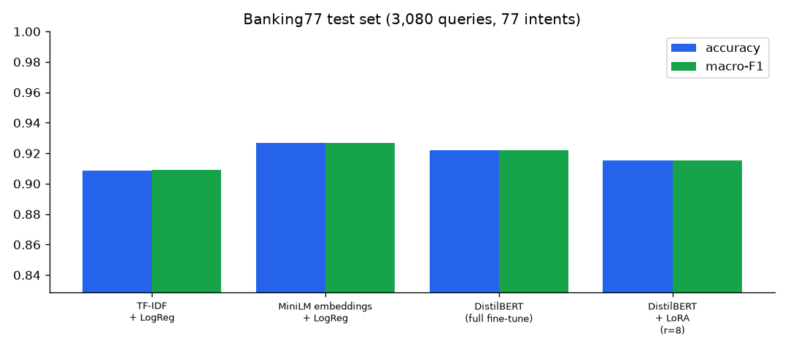
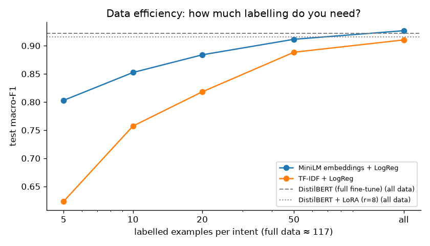
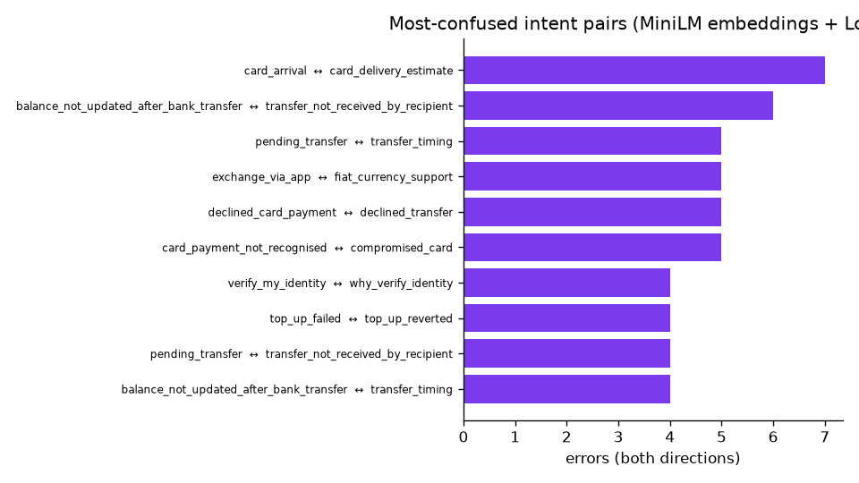
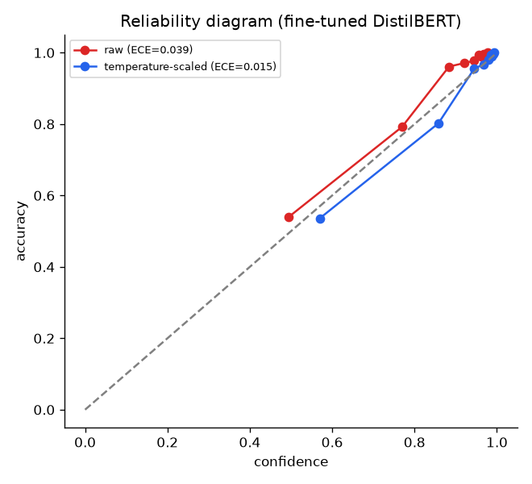

# Intent Classification: Classic ML vs Embeddings vs Fine-Tuned Transformers (+ LoRA)


 

Routing customer messages to the right intent is a core NLP problem for banks and support teams.
This project benchmarks four approaches on **Banking77** (13,083 real customer queries, **77 fine-grained
intents**) and asks the practical question: *which one should you ship?*

| Approach | Idea |
|---|---|
| TF-IDF + logistic regression | Word + character n-grams; the strong classical baseline |
| Frozen sentence embeddings + LR | `all-MiniLM-L6-v2` embeddings, no fine-tuning |
| DistilBERT full fine-tune | All 67M parameters updated (plain PyTorch loop, early stopping on macro-F1) |
| DistilBERT + LoRA (r=8) | Low-rank adapters on attention — only **1.2%** of parameters trained |

## Results (held-out test set, 3,080 queries)

| Model | Accuracy | Macro-F1 | Calibration error (ECE) | Trainable params | CPU latency / query |
|---|---|---|---|---|---|
| TF-IDF + LogReg | 90.9% | 0.909 | 0.139 | 2.7M | **0.04 ms** |
| **MiniLM embeddings + LogReg** | **92.7%** | **0.927** | 0.075 | **30K** | 2.4 ms |
| DistilBERT (full fine-tune) | 92.2% | 0.922 | 0.039 → **0.015** after temperature scaling | 67M | 14.0 ms |
| DistilBERT + LoRA (r=8) | 91.5% | 0.916 | **0.012** | 0.8M | 14.8 ms |

*All models trained on CPU (GitHub Actions runner); fine-tuning took ~40 min per model.*



### Key findings
1. **The cheapest neural option won.** Frozen sentence embeddings + a linear classifier matched or beat
   fine-tuned DistilBERT, while being **6× faster at inference** and training in 30 seconds instead of 40 minutes.
   On a CPU budget, with short texts, a strong pretrained embedding model is the best accuracy/cost trade-off.
2. **Embeddings shine when labels are scarce.** With only **5 labelled examples per intent**, embeddings reach
   **0.80 macro-F1 vs 0.62 for TF-IDF** — they need ~4× fewer labels to hit the same score.
3. **LoRA gets within 0.7 points of full fine-tuning while training 84× fewer parameters** — and it is the
   best-calibrated model out of the box. That's what makes per-customer adapters cheap to store and serve.
4. **Confidence scores need calibrating before you trust them for routing.** TF-IDF probabilities are badly
   miscalibrated (ECE 0.14); one temperature parameter fitted on validation data cuts DistilBERT's ECE from 0.039 to 0.015.



### Error analysis
The remaining errors are mostly **genuinely ambiguous intent pairs**, not model failures — e.g.
`card_arrival ↔ card_delivery_estimate` and `pending_transfer ↔ transfer_timing`. The weakest intents
(F1 ≈ 0.78) are all transfer-status questions that differ by a word or two. In production these pairs are
candidates for merging, or for a clarifying follow-up question. 25 of the most confident mistakes are in
[`reports/error_examples.csv`](reports/error_examples.csv).




## How it works
- **Plain PyTorch fine-tuning loop** (no `Trainer`): dynamic padding, linear warm-up/decay, gradient clipping,
  early stopping on validation macro-F1 — every step is visible in [`finetune.py`](src/textclf/finetune.py).
- **LoRA via PEFT** on DistilBERT's `q_lin`/`v_lin` projections; the new classification head is trained fully.
- **Temperature scaling** (Guo et al., 2017) fitted on the validation split; **ECE** with 15 bins.
- **Offline tests**: tiny randomly-initialised DistilBERT + hashing tokenizer, so CI never downloads a model.
- The `Benchmark` workflow re-runs the full experiment on GitHub Actions and commits `reports/`.

## Run it
```bash
pip install torch --index-url https://download.pytorch.org/whl/cpu
pip install -r requirements-dev.txt && pip install -e .
pytest -q                              # 7 offline tests
python -m textclf.experiment --smoke   # whole pipeline in ~1 min with tiny models
python -m textclf.experiment           # full benchmark (~2 h on CPU, much faster on GPU)
```

## Data
[Banking77](https://github.com/PolyAI-LDN/task-specific-datasets) (Casanueva et al., 2020, PolyAI) — 10,003 train /
3,080 test queries. 10% of train is held out for validation and early stopping.
